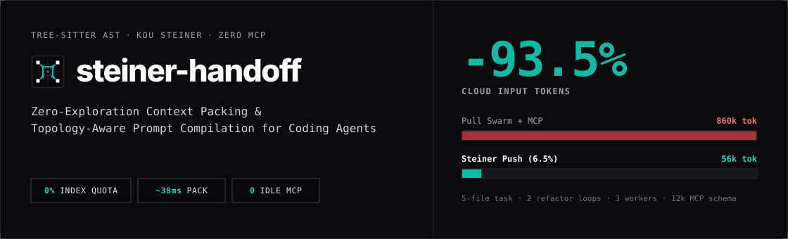
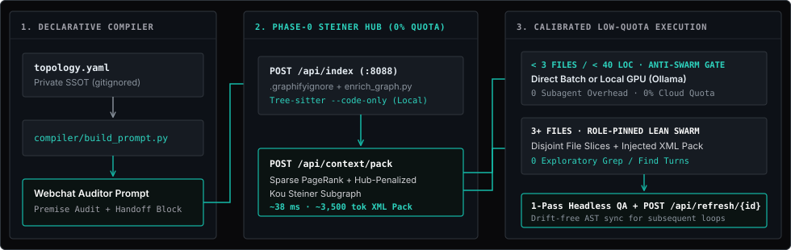

<p align="center">
  
</p>

<p align="center">
  <a href="./LICENSE"></a>
  
  
  
  
</p>

<p align="center">
  <a href="#why-agent-quotas-collapse">Why Quotas Collapse</a> &middot;
  <a href="#architecture">Architecture</a> &middot;
  <a href="#token-burn--quota-benchmarks">Benchmarks</a> &middot;
  <a href="#how-the-steiner-packer-works">Steiner Packer</a> &middot;
  <a href="#3-minute-quickstart">Quickstart</a> &middot;
  <a href="#hub-http-api-reference">HTTP API</a> &middot;
  <a href="#tier-1-privacy-firewall">Privacy Firewall</a>
</p>

> **Interactive Microsite:** Explore the [Live Quota Simulator, Prompt Compiler Sandbox, and Steiner Graph Visualizer](https://chiminaca.github.io/steiner-handoff/) on GitHub Pages.

---

## Why Agent Quotas Collapse

When coding agents or multi-agent swarms use **pull-based discovery** (`grep`, `find`, `cat`, or persistent Code MCP tool schemas), input token consumption scales **quadratically** with turn depth $T_w$:

$$C_{\text{total}} = \sum_{w=1}^{W} \sum_{t=1}^{T_w} \left( S_{\text{sys}} + S_{\text{mcp}} + \sum_{k=1}^{t} S_{\text{obs}, k} \right)$$

Every exploratory tool call appends file reads and search hits into the rolling context window, and every idle MCP server injects $S_{\text{mcp}}$ schema tokens on every single turn—even when no tool is called.

`steiner-handoff` flips the model from **Pull** to **Deterministic Push**:

1. **Zero Cloud Index Quota:** Tree-sitter (`--code-only`) extracts AST call graphs locally in **~38 ms** with `0%` cloud LLM calls.
2. **Zero Idle MCP Tax:** All context is delivered as a single ~3,500-token `<xml_pack>` in the initial handoff prompt.
3. **Anti-Swarm Gate:** Tasks touching `< 3` files or `< 40` LOC bypass swarm spawning entirely and route to a single direct batch or local GPU offload.

---

## Architecture

<p align="center">
  
</p>

1. **Declarative Compiler (`compiler/build_prompt.py`):** Compiles a private `topology.yaml` (your nodes, models, presets, and privacy rules) into target-specific `dist/WEBCHAT_SYSTEM_PROMPT.md` and `dist/WEBCHAT_COMPACT_BOOSTER.md` artifacts.
2. **Local AST Context Hub (`hub/app/`):** FastAPI service indexing repositories via Tree-sitter (`ast_extractor.py`), solving the Hub-Penalized Kou Steiner Tree (`steiner_packer.py`), and enforcing Tier-1 isolation (`privacy_guard.py`).
3. **Zero-Exploration Execution:** Disjoint file slices receive pre-packed `<xml_pack>` bundles; workers edit immediately without `grep`/`find` loops, then trigger `POST /api/refresh/{project_id}` to prevent graph drift.

---

## Token Burn & Quota Benchmarks

Measured on a **5-file feature task** with **2 refactor loops**, **3 parallel workers**, and a **12,000-token MCP schema**:

| Strategy | Input Tokens | Relative Burn | Idle MCP Tax | Exploration Turns |
| :--- | ---: | ---: | ---: | ---: |
| **Pull Swarm + Code MCP** | `860,000 tok` | `100.0%` | `12k tok / turn` | High (`grep` / `cat` loops) |
| **Static Repo Dump (Repomix)** | `520,000 tok` | `60.5%` | `0` | Medium (re-reads on loops) |
| **AST Signature Map (RepoMap)** | `255,000 tok` | `29.7%` | `0` | Low-Medium |
| **`steiner-handoff` (Push)** | **`56,000 tok`** | **`6.5%` (`-93.5%`)** | **`0`** | **Zero** |

---

## Ecosystem Comparison

| Capability | `steiner-handoff` | Code MCP Servers | Static Repo Dumps | AST RepoMaps |
| :--- | :--- | :--- | :--- | :--- |
| **Idle Schema Tax** | `0 tokens` | `8k–24k tokens/turn` | `0 tokens` | `0 tokens` |
| **Hub Gravity-Well Bypass** | Yes (Kou Steiner $\alpha=1.4$) | No | No | Partial (PageRank) |
| **Declarative Prompt Compiler** | Yes (`topology.yaml` $\to$ `dist/`) | No | No | No |
| **Tier-1 Privacy Firewall** | Yes (Hard egress block) | Manual | Manual | Manual |
| **Anti-Swarm Gate (`<3` files)** | Built-in | No | No | No |

---

## How the Steiner Packer Works

Naive shortest-path graph traversal falls into **hub gravity wells**: utility modules like `core/utils.py` ($\deg = 42$) sit 1 hop from everything, pulling dozens of unrelated files into the context window.

`steiner-handoff` penalizes high-degree hubs during Kou's 2-approximation Steiner Tree metric closure:

$$w'(u, v) = w(u, v) \cdot \left(1 + \alpha \ln(1 + \deg(v))\right)$$

With $\alpha = 1.4$, paths through `core/utils.py` become expensive, forcing the packer to route across **semantic bridges** (`order_schema.py`, explicit architectural invariants from `enrich_graph.py`) connecting only the exact terminal seed files.

<p align="center">
  <a href="https://chiminaca.github.io/steiner-handoff/#pages-steiner-viz"></a>
</p>

---

## 3-Minute Quickstart

```bash
git clone https://github.com/chiminaca/steiner-handoff.git
cd steiner-handoff

python3 -m venv .venv
source .venv/bin/activate
pip install -r hub/requirements.txt

# 1. Create your private topology (gitignored) from the sanitized example
cp topology.example.yaml topology.yaml

# 2. Compile your webchat auditor & booster prompts into dist/
python compiler/build_prompt.py --topology topology.yaml --out dist/
```

Start the local AST Context Hub and pack context for a task:

```bash
# 3. Run the local FastAPI Hub (loopback only by default)
uvicorn hub.app.main:app --host 127.0.0.1 --port 8088

# 4. Index a repository (0% cloud quota) and pack a ~3,500-token Steiner bundle
curl -s -X POST http://127.0.0.1:8088/api/index \
  -H "Content-Type: application/json" \
  -d '{"project_id": "checkout-api", "root_path": "/path/to/repo"}'

curl -s -X POST http://127.0.0.1:8088/api/context/pack \
  -H "Content-Type: application/json" \
  -d '{"project_id": "checkout-api", "seeds": ["cart.py", "orders.py"], "max_tokens": 3500}'
```

---

## Hub HTTP API Reference

| Method | Endpoint | Purpose |
| :--- | :--- | :--- |
| `GET` | `/api/projects` | List indexed repositories and their privacy tiers |
| `POST` | `/api/index` | Run deterministic Tree-sitter AST extraction (`0%` LLM quota) |
| `POST` | `/api/context/pack` | Compute Hub-Penalized Kou Steiner bundle (`<xml_pack>`) |
| `POST` | `/api/refresh/{project_id}` | Re-index modified files after task completion to prevent drift |
| `GET` | `/health` | Return hub readiness and active graph count |

---

## Tier-1 Privacy Firewall

Repositories matching sensitive path patterns (e.g., `**/finance/**`, `**/legal/**`, or `private: true` in `topology.yaml`) are enforced by `hub/app/privacy_guard.py`:

- **Cross-Graph Isolation:** Tier-1 nodes and edges are never merged into `global-graph.json`.
- **Cloud Egress Block:** `POST /api/context/pack` rejects cloud-bound handoff requests targeting Tier-1 repositories unless routed exclusively to a local inference endpoint (`127.0.0.1`).
- **Static OPSEC Gate:** Run `python scripts/opsec_check.py` before committing to verify zero RFC1918 IPs, local paths, tokens, or private keys exist in tracked files.

---

## Repository Layout

```text
steiner-handoff/
├── assets/                   # Standalone Swiss-CAD SVGs (hero, architecture, steiner-pruning, logo)
├── bootstrap/                # Graph invariant enrichment templates
├── compiler/                 # Declarative topology.yaml -> dist/ prompt compiler
├── docs/                     # Standalone GitHub Pages microsite (no CDN Tailwind, no FOUC)
├── hub/                      # FastAPI AST indexer, Kou Steiner packer & Tier-1 privacy guard
├── presets/                  # Target agent presets (Antigravity, Claude Code, Aider)
├── scripts/                  # Static OPSEC scanner, OG social preview & docs source sync
├── topology.example.yaml     # Sanitized reference topology
└── LICENSE                   # MIT License
```

---

## License

Released under the [MIT License](./LICENSE).
